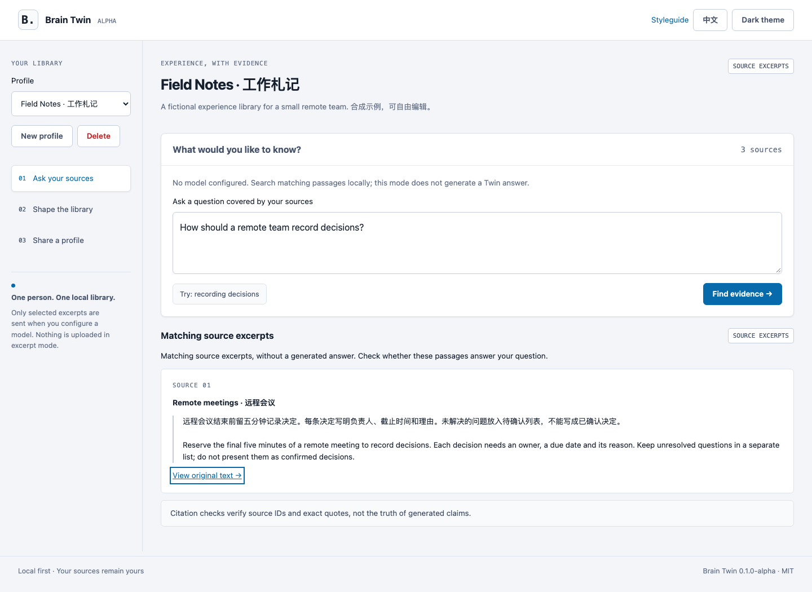

# Brain Twin

Turn a small set of notes into a source-grounded experience library. Ask a question, inspect the matching passages, and share only the material you choose.

**Alpha · local, single-user · English / 中文 · MIT**

No model is required. The default mode returns **source excerpts**, clearly labeled as excerpts. A configured model can generate an answer from retrieved passages; every citation must reference a retrieved source and quote its text exactly. These checks do **not** prove that a generated claim is true.

[中文说明](README.zh-CN.md) · [Architecture and API](docs/architecture.md) · [Security](SECURITY.md) · [Design](DESIGN.md)



## Run locally

Python 3.10 or later is required. From a downloaded source checkout:

```sh
python3 -m venv .venv
. .venv/bin/activate
python -m pip install .
brain-twin
```

On Windows, activate with `.venv\Scripts\activate` instead. Open **http://127.0.0.1:5043**. The command works from any directory after installation. Alternatively, run `python -m brain_twin.app`.

The fictional **Field Notes** profile is available on first launch. Click **Try: recording decisions**, then **Find evidence**. Open a citation to inspect the original text. Ask about Jupiter's moons to see an explicit “insufficient sources” response.

## Make it yours

1. Open **Shape the library**. Edit the name, description, answer preferences and source texts using ordinary forms. Add or remove sources, then **Save library**.
2. Open **Ask your sources**. Questions use the saved library; unsaved changes must be saved first.
3. Open **Share a profile**. Select the sources, preview the exact package, and download the reviewed JSON. It contains profile metadata and the **full text** of selected sources. It excludes questions, answers and configured credentials. Secrets pasted into a source are still source text: review before sharing.
4. Another person can select that JSON file, preview it and import it as a new profile. Existing profiles are not overwritten.

Source text is the only input format in this alpha. It does not fetch URLs, scan directories, ingest documents or access your accounts. The example contains synthetic material only.

## Optional model answers

Set the following **in the shell before starting**. `BRAIN_MODEL_URL` is the full chat-completions endpoint, not a base URL:

```sh
export BRAIN_MODEL_URL='http://127.0.0.1:1234/v1/chat/completions'
export BRAIN_MODEL_NAME='your-local-model'
brain-twin
```

For a remote provider, use an HTTPS endpoint and configure `BRAIN_MODEL_KEY` in the process environment through your usual secret manager. Do not put a real key in source files, source notes, shared packages or browser code. A key is optional for local servers. A partial URL/name configuration fails at startup.

The provider must accept `messages`, `model`, `stream: false`, `temperature`, `max_tokens`, and `response_format: {"type": "json_object"}`. It must return a JSON object as `choices[0].message.content`:

```json
{
  "status": "answered",
  "answer": "Record the owner of each decision.",
  "citations": [
    {"source_id": "meeting-notes", "quote": "Each decision needs an owner"}
  ]
}
```

If evidence is insufficient, return `status: "insufficient"` with an empty `citations` list. Invalid JSON, invented IDs, non-verbatim quotes, HTTP errors and timeouts are visible failures. They never silently fall back to excerpt mode. The app sends the question, answer preferences and at most four retrieved excerpts to the configured provider; it does not send other profiles or the complete library. Endpoint redirects are refused, and provider response bodies are not shown in errors.

No real or paid model was used to test this alpha. Provider compatibility and answer quality remain your responsibility; the tests use an HTTP service on the loopback interface.

## Storage and limits

- Default data directory: `~/.local/share/brain-twin`. Override with `BRAIN_TWIN_DATA_DIR` before launch.
- `profiles.json` is saved by atomic replacement with a single-process lock. Corrupt data causes a startup error instead of being replaced. Back up this file when the app is stopped.
- One process only. There is no account system, multi-process coordination, encryption at rest or collaborative editing. Two open tabs can overwrite each other's profile edits; save carefully.
- Questions and results remain in process memory only. Jobs expire after 15 minutes and are lost on restart. They are never included in shared packages.
- At most 30 profiles, 50 sources per profile, 30,000 characters per source and 200,000 source characters per profile. Request bodies are limited to 2 MiB.
- Questions are limited to 4,000 characters. Retrieval returns at most four passages, each up to 900 characters. The model receives only these passages; other material can be missed.
- Two workers, at most four queued/running jobs, and at most 64 retained jobs. Full queues return HTTP 503. Each provider socket operation has a 25-second timeout and responses are capped at 128 KiB.

`brain-twin --port 5053` changes the port. The server always binds to `127.0.0.1`. This is a personal local tool: do not expose the Flask development server to the Internet or use it for shared hosting.

## Retrieval and truthfulness

Retrieval uses Chinese character bigrams and Latin word tokens with lexical overlap. It is offline and deterministic, but does not understand meaning or reliably match synonyms. Short or ambiguous questions can miss relevant material or match the wrong passage. Excerpts make no claim to answer the question. Model mode rejects unknown source IDs and quotes absent from retrieved excerpts, but a real quote can still be used misleadingly. Check the original text before relying on an answer. Source content is untrusted input; prompt injection resistance is not guaranteed.

Changing the selected profile, editing sources or changing the question clears the previous answer. Starting another request also clears it, including when that request fails. Results are tied to the exact saved profile version, question and request; a late response cannot replace a newer answer, even if you switch away and back. If another tab saved different data, reload the page before asking again. Discarding a browser result does not cancel work already running on the server.

## Development

```sh
python -m pip install '.[test]'
python -m pytest
python -m pip install build
python -m build
```

Tests cover Chinese retrieval, insufficient evidence, source edits/deletion, atomic persistence, export selection, import roundtrip, CSRF/Origin/Host defenses, XSS-safe rendering contracts, bounded jobs, model wire fields, invalid citations, provider errors, redirect rejection, and UI token/contrast invariants. HTTP tests bind only loopback and require permission to open a local listening socket. CI tests Python 3.10 and 3.14 and builds a wheel.

For the real browser flow (Chromium):

```sh
python -m pip install playwright
python -m playwright install chromium
python scripts/browser_smoke.py
python scripts/browser_regressions.py
```

The regression script covers answer invalidation, late-response races and session coexistence with another app on a different local port. Both browser scripts run in CI. `/styleguide` renders the actual components in both themes. [Screenshots](docs/screenshots) include desktop, mobile, source evidence and sharing. No front-end build step, CDN or external font is needed.
