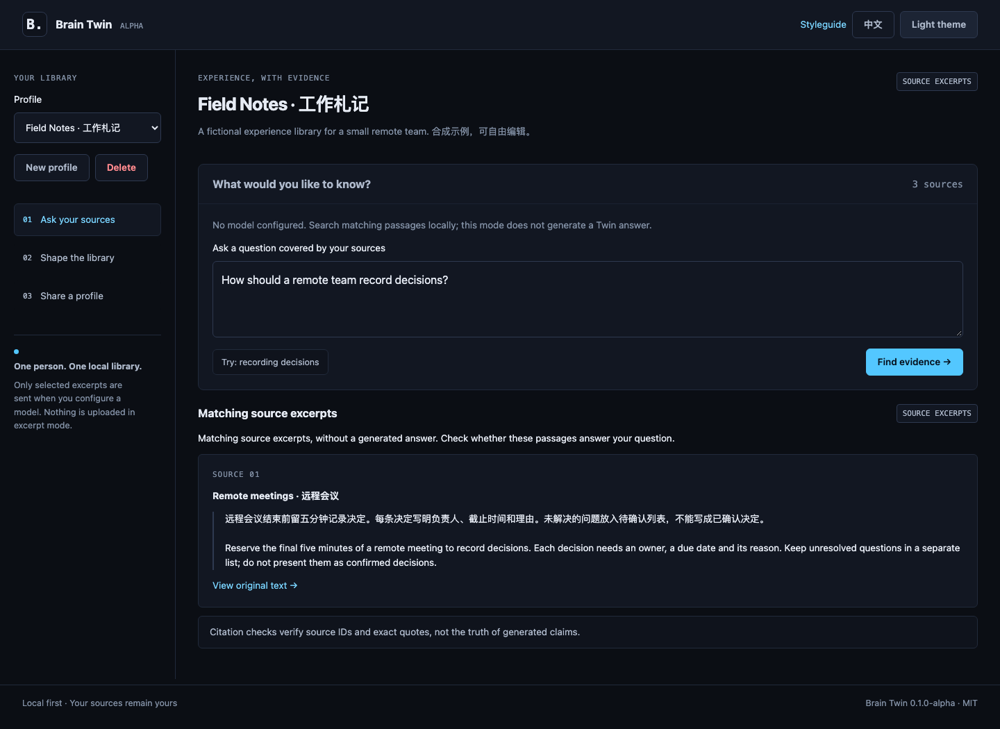

# Brain Twin

## 把你的经验，变成别人可以提问的资料库。

怎么开好一次会、怎样审一篇稿、做决定时看哪些依据——你可能早就写过。有人再问起时，这些经验值得被重新用上。

**Brain Twin 把你选定的文本放进一个本地经验库：提出问题，找到相关段落，打开原文核对。** 配置模型后，还可以根据这些段落生成带来源的回答。

[试用示例](#试用示例) · [下载 Alpha](https://github.com/Xfireman/brain-twin/releases/tag/v0.1.0-alpha.1) · [English](README.md)

本地运行 · 中英界面 · MIT 开源 · Alpha

### 从一个别人真的会问你的问题开始

“会议结束前，到底该记下什么？”

内置的虚构“工作札记”里，有这样一段经验：

> 远程会议结束前留五分钟记录决定。每条决定写明负责人、截止时间和理由。未解决的问题放入待确认列表，不能写成已确认决定。

问如何记录决定，Twin 会找出对应段落。点开来源，可以检查全文；再试问资料没有涉及的话题，体验资料不足提示。

无需 API key 就能体验这条“提问 → 找到原文”的路径。配置模型后，可以把相关摘录组织成回答并附上引用；原文依然能打开核对，引用匹配本身不保证结论正确。



*默认显示来源摘录。内置资料与截图均为虚构素材。*

### 给值得复用的经验，一个集中入口

- **你自己的工作方法**：会议、写作、实验、项目决策中的笔记。
- **别人总来问的指南**：把反复解释的内容放在一起，方便再次查用。
- **围绕一个主题挑选的建议**：保持资料范围清楚，每一条都能找到出处。

粘贴你选定的文本，给来源起名，保存即可。名称、描述、风格偏好和原文都通过普通表单编辑。首版接受粘贴文本，暂不支持上传文档、抓取网页或自动导入账户内容。

### 只分享你选好的那部分

勾选来源，预览完整内容，下载档案包。另一位使用者在自己的 Twin 里导入后，就可以提问或继续修改这份资料库。

共享包包含所选来源的完整正文和档案设置，不包含问答历史或配置密钥。分享通过传文件完成；选中的正文需要你自己核对隐私。

## 试用示例

需要 Python 3.10+ 和 Git。macOS / Linux 执行：

```sh
git clone https://github.com/Xfireman/brain-twin.git
cd brain-twin
python3 -m venv .venv
. .venv/bin/activate
python -m pip install .
brain-twin
```

打开 **http://127.0.0.1:5043**，需要时切换到中文：

1. 在“工作札记”里点击“试问：如何记录决定”，再“查找依据”。
2. 打开来源，检查完整笔记。
3. 问“木星的卫星有多少颗？”，体验资料未覆盖的问题。
4. 进入“整理资料库”，添加一段自己的笔记并保存，再用其中的词提出问题。

现在你已经看过“找到依据”和“资料不足”两种情况。需要根据摘录生成回答时，可以[连接模型](#可选模型)。

Windows 使用 `py -m venv .venv` 创建环境，执行 `.venv\Scripts\activate` 激活。也可[下载源码压缩包](https://github.com/Xfireman/brain-twin/releases/tag/v0.1.0-alpha.1)，解压后在目录中安装。安装后可在任意目录运行 `brain-twin`，加 `--port 5053` 可更换端口。

### 先从一小份好资料开始

Twin 适合**范围明确、你希望随时检查原文的经验资料**。本地检索按英文词项和中文双字片段匹配，同义改写可能漏掉；资料选择与人工判断仍然重要。

想把方法交给 AI 反复执行，看 [Brain Recipes](https://github.com/Xfireman/brain-recipes)；想把未完成的任务交给下一段对话，看 [Brain Relay](https://github.com/Xfireman/brain-relay)。

## 可选模型

<details>
<summary>展开模型配置和引用规则</summary>

在启动前设置环境变量。地址必须是完整的 chat-completions URL：

```sh
export BRAIN_MODEL_URL='http://127.0.0.1:1234/v1/chat/completions'
export BRAIN_MODEL_NAME='your-local-model'
brain-twin
```

远程服务必须使用 HTTPS；本地回环地址允许 HTTP。需要密钥时，通过自己的秘密管理工具向进程注入 `BRAIN_MODEL_KEY`。不要把真实密钥写进源码、笔记、浏览器或共享包。URL 与模型名称必须同时设置；不完整配置会拒绝启动。

模型服务需支持 `response_format: {"type": "json_object"}`，并按[英文说明](README.md#optional-model-answers)返回 `status`、`answer`、`citations`。每条引用必须包含已检索来源 ID 和该摘录中逐字存在的引文。不足时返回 `insufficient` 和空引用列表。错误 JSON、伪造引用、模型错误或超时都会明确失败，不会静默改用摘录模式。

应用只发送问题、风格偏好和最多四段相关摘录。它不发送其他档案或完整资料库。不跟随上游重定向，不将上游错误正文展示给浏览器。本 Alpha 仅使用本地合成 HTTP 服务测试，没有调用真实或付费模型。

</details>

## 数据与实际限制

<details>
<summary>展开存储、检索与使用限制</summary>

数据默认保存到 `~/.local/share/brain-twin/profiles.json`，可用 `BRAIN_TWIN_DATA_DIR` 修改。采用原子写入和单进程锁；文件损坏时拒绝启动，不覆盖原数据。停止应用后备份该文件。

这是单进程、单人本地工具，没有账户系统、磁盘加密、多进程协调或多人协作。多个标签页可能覆盖彼此的修改。问答只保留在进程内存，任务 15 分钟过期，重启即消失；不写进共享包。

最多 30 个档案、每档案 50 条来源、每条 30,000 字符、每档案来源合计 200,000 字符；问题最多 4,000 字符。检索最多返回四段、每段 900 字符。两个工作线程，最多四个排队或运行任务、保留 64 个结果；满载时返回 503。上游单次 socket 操作超时 25 秒，响应最多 128 KiB。

中文采用双字词片段、英文采用词项匹配。它不理解语义，可能漏掉同义词或匹配到错误段落。**引用有效只证明来源 ID 和引文真实存在，不保证模型结论语义正确。** 原文中的提示注入也不能保证完全抵抗。依赖回答前，请核对全文。

切换档案、编辑来源、修改问题或发起新请求时，旧回答会清除；新请求失败也不会继续展示旧答案。回答绑定本次请求、问题和完整资料版本，切走再切回或较晚到达的旧回包都不能覆盖新回答。另一标签页保存了不同资料时，请刷新后再提问。丢弃浏览器结果不会取消已在服务端运行的任务。

`brain-twin --port 5053` 可修改端口。始终只绑定 `127.0.0.1`，不要把开发服务器公开到互联网。

</details>

## 验证与开发

<details>
<summary>展开测试、浏览器验证与开发说明</summary>

```sh
python -m pip install '.[test]'
python -m pytest
python -m pip install build
python -m build
```

覆盖中文命中、无关拒答、增删改、持久化、分享选择和往返、CSRF/Origin/Host、防 XSS、任务上限、实际模型请求字段、伪造引用、模型错误、重定向拒绝、两主题对比度。测试的 HTTP 服务只绑定本地回环地址。CI 使用 Python 3.10 和 3.14，并构建 wheel。

浏览器主流程验证：

```sh
python -m pip install playwright
python -m playwright install chromium
python scripts/browser_smoke.py
python scripts/browser_regressions.py
```

回归脚本覆盖回答失效、异步回包竞态及不同本地端口应用的会话共存，两个浏览器脚本均接入 CI。`/styleguide` 展示真实双主题组件；[截图目录](docs/screenshots)包含桌面、手机和分享预览。无需前端构建，不加载 CDN、第三方字体或分析脚本。

</details>
